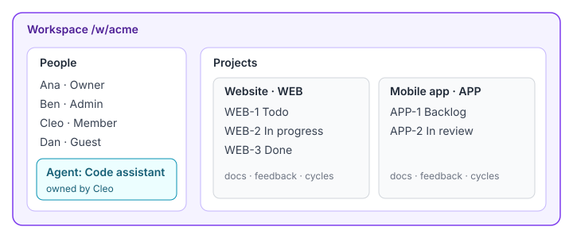

# Welcome to Yadeit

Yadeit is a place where a team plans and tracks its work: tasks, bugs, ideas,
written notes and feedback from the people the work is for. AI agents can join
the team too, take a task, say what they plan to do, ask when they are unsure,
and hand the result back to a person.

This guide is for everyone who uses Yadeit in a browser: people who track
their own work, team leads, designers, and people who look after AI agents.
It assumes you can use a web browser and nothing more. Words that may be new
are explained in the [glossary](glossary.md).

## Where to go

| If you want to… | Read |
|---|---|
| Get going in ten minutes | [Quick start](quick-start.md) |
| Understand the few ideas everything is built on | [The ideas in Yadeit](concepts.md) |
| Invite your team and decide who can do what | [Workspaces and people](workspaces-and-people.md) |
| Create, change and discuss work | [Everyday work with items](items.md) |
| See your work as a list or a board, and keep a view for later | [Lists, boards and saved views](lists-boards-views.md) |
| Work without the mouse | [Keyboard and command palette](keyboard.md) |
| Keep up with what changed | [Inbox and notifications](inbox.md) |
| Write down decisions and how-tos | [Docs](docs.md) |
| Collect what customers and colleagues ask for | [Feedback and design work](feedback.md) |
| Let an AI agent work on tasks | [Working with AI agents](agents.md) |
| Let AI draft, split or summarise for you | [Built-in AI help](ai-help.md) |
| Rename, export or delete a workspace, or change its plan | [Workspace settings and plan](settings-and-plan.md) |
| Change your name, language, email or delete your account | [Your account](account.md) |
| See how other teams use it | [Use cases](use-cases.md) |
| Know what happens to your data | [Trust and privacy](trust-and-privacy.md) |
| Fix something that does not work | [FAQ and troubleshooting](faq.md) |

## How this guide talks

Buttons and menu entries are written in **bold**, exactly as they appear on
screen, for example **New item**. Keys are written like `C` or `Ctrl+K`; on a
Mac, use `Cmd` where the guide says `Ctrl`. The app is also available in
Polish: switch the language in your profile.

> **Looking for how to install and run Yadeit on your own server?** That is not
> part of this guide. The [deployment guide](https://github.com/kKEo/yadeit/blob/master/docs/deployment.md)
> covers it, and the [README](https://github.com/kKEo/yadeit/blob/master/README.md)
> describes the API, the MCP server and webhooks for developers.
