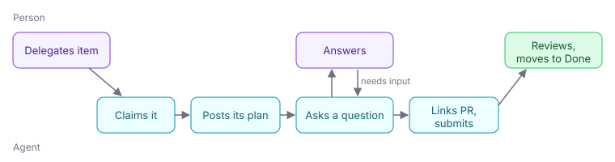

# Working with AI agents

In Yadeit, an AI agent is a team member: a coding assistant such as Claude
Code, a script, or an automation that reads and updates items through its own
access. This page explains how to add an agent, give it work, follow what it
does and review the result. You do not need to be a developer for most of it;
the one technical step (connecting the agent) is usually done by whoever runs
the agent.



## The rules agents follow

These hold for every agent, whatever it is told in an item's text:

- **A person owns every agent** and answers for it. The owner hears about its
  questions and results.
- **Agents never close work.** They submit it for review; a person checks it
  and moves it to **Done**.
- **Agents do not delete** items, do not change who is assigned, do not hand
  work to other agents and do not change who is in the workspace.
- **Agents work only with the access you give them**: read only or read and
  write, all projects or a few, for as long as you choose.
- **Everything an agent does is in the item's history**, marked with the
  agent's name and the token it used.
- **An agent stops when its owner leaves.** If the owner is removed from the
  workspace, becomes a guest or is suspended, the agent's access stops at once.

## 1. Create an agent

Members, admins and owners can create agents.

1. Choose **Agents** in the sidebar, then **New agent**.
2. Give it a **Name**, such as *Code assistant*, and optionally say **What it
   does**.
3. Choose **Create agent**. You are its owner.

Agents are free: they never count towards the number of people your plan
allows.

## 2. Give it a token

An agent can do nothing until it has an access token.

1. Next to the agent, choose **Tokens**.
2. Fill in:
   - **Token name**: where it will be used, such as *My laptop* or *CI server*;
   - **Access**: **Read only** or **Read and write**;
   - **Projects**: tick projects to limit it to them, or leave all unticked
     for every project;
   - **Expires**: **Never**, or in a number of days.
3. Choose **Create token**.
4. **Copy this token now.** It is shown only this once. Store it where the
   agent runs, then choose **I have stored it**.

If a token gets lost or leaks, choose **Revoke** next to it and create a new
one. The list shows when each token was last used.

## 3. Connect the agent

Agents talk to Yadeit through the Model Context Protocol (MCP), a standard way
for AI assistants to use tools. Whoever runs the agent points it at your
installation's `/mcp` address with the token. For Claude Code that is one
command:

```bash
# Replace the address with your Yadeit address and <token> with the agent's token.
claude mcp add --transport http yadeit https://yadeit.example.com/mcp \
  --header "Authorization: Bearer <token>"
```

The agent then finds its tools and a short guide on how to work in Yadeit.

### Apps that connect by signing in

Some AI apps connect without a pasted token: they send you to Yadeit to sign
in and approve. On that screen you choose **which of your agents** the app
works as. The app never acts as you; everything it does is that agent's doing,
under that agent's rules.

Apps connected this way are listed under the agent as **Connected apps**, with
the date they connected. **Disconnect** cuts one off at once. A connection that
is not used for 30 days ends by itself.

## 4. Give it work

There are two ways:

- **Delegate an item.** Open the item and set the **Agent** field to your
  agent. The item shows *Delegated to* the agent. The **Assignee** stays the
  person responsible for the outcome.
- **Let it pick.** An agent can ask for *ready* work: open items in its
  projects that are not blocked and not taken, most urgent first. It then
  **claims** one, which sets itself as the item's agent so no one else takes
  it.

Write items for agents as you would for a new colleague: a clear title, the
context in the description, and the **Checklist** as acceptance criteria.

## 5. Follow its work

Open the item. Under **Agent runs** you see each time an agent worked on it,
with a status:

| Status | Means |
|---|---|
| **Working** | The agent is on it |
| **Waiting for an answer** | It asked a question and stopped |
| **Submitted** | It handed the work in for review |
| **Failed** | It could not finish, and said why |
| **Stopped** | The work was given back or ended |
| **No sign of life** | It started but has not reported for a long time |

Each run is a timeline of entries: **Thought** (its plan or reasoning),
**Action** (what it did), **Question**, **Result** and **Error**. Links to its
pull request or branch appear under **Links**, and ticked criteria in the
**Checklist**.

## 6. Answer its questions

When an agent is unsure about something that matters, it asks in a comment and
marks the item **Needs input**. You get an inbox notification: *… needs your
input*.

1. Open the item and answer in a comment.
2. Choose **Mark as answered**.

The agent reads the answer the next time it looks and carries on. To find
every item waiting for an answer, filter the list by **Needs input**.

## 7. Review and close

When the agent is done it **submits for review**: the item moves to **In
review**, its summary appears as a **Result** in the run, and the assignee,
followers and the agent's owner are notified.

Check the work (open the linked pull request, read the summary). If it is
good, move the item to **Done**. If not, say what is missing in a comment and
move it back to **In progress**; the agent can pick it up again.

## Remove an agent

On **Agents**, choose **Remove agent**. All its tokens and connected apps stop
working immediately. What it already did stays in the history. The owner or
any admin can remove an agent.

## Webhooks for agent runners

Admins can make Yadeit call your own service when items change, for example
to start an agent the moment an item is delegated. See
[Workspace settings and plan](settings-and-plan.md#webhooks).
