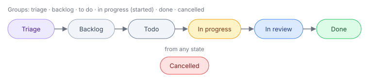

# The ideas in Yadeit

Yadeit is built on a short, fixed list of ideas. This page explains each one in
a sentence or two, so the rest of the guide reads easily. Nothing here needs
setting up; it is how the app works.

## Workspace

Your team's own space. It holds projects, people, docs and settings. People in
one workspace never see another workspace unless they are a member of it too.
You can belong to several workspaces and switch between them from the top of
the sidebar.

## Member and role

Everyone in a workspace is a member with one role: **Owner**, **Admin**,
**Member** or **Guest**. The role decides what they may do. See
[Workspaces and people](workspaces-and-people.md).

## Agent

An AI assistant, script or automation that works in the workspace like a
member. Every agent has a person who owns it and answers for what it does. See
[Working with AI agents](agents.md).

## Project

A group of related work with a short key, such as `WEB` or `APP`. Every item
belongs to exactly one project and is numbered under its key.

## Item

One piece of work: a task, a bug, a feature, a piece of design or research.
Items are called by their key, for example `WEB-143`, so you can say it, type
it and search for it. Only the title is required.

## State

Where an item is in its life. Every project starts with these states:

| State | Means |
|---|---|
| Triage | Arrived from outside and nobody has looked at it yet |
| Backlog | Worth doing some day, not planned yet |
| Todo | Planned, nobody has started |
| In progress | Someone is working on it |
| In review | The work is done and waits for a person to check it |
| Done | Finished |
| Cancelled | Will not be done |

Each state belongs to one of six fixed **groups**: triage, backlog, to do
(not started), in progress (started), done (completed) and cancelled. Lists,
boards and filters work on the groups, so they keep working even if a project
names its states differently.

## Priority

How urgent an item is: **No priority**, **Low**, **Medium**, **High** or
**Urgent**. The scale is the same everywhere.

## Kind

What sort of work an item is: **Task**, **Bug**, **Feature**, **Design** or
**Research**. The kind is a label for finding things; it does not change how
the item behaves.

## Label

A free tag on an item, such as *frontend* or *customer-x*. Labels belong to a
project, and an item can have several.

## Comment and activity

Comments are the conversation on an item. Activity is the item's history:
every change, who made it and when. Both are on the item itself.

## Cycle

A fixed stretch of time, such as two weeks, that a project can plan in. When a
cycle ends, the next one starts and unfinished items move along by themselves.
See [Projects and planning](projects-and-planning.md).

## View

A way of looking at items: which ones (filters), how (list or board), grouped
and sorted how. A view you like can be saved under a name and shared.

## Doc

A written page next to the work: a decision, a how-to, a specification. Docs
belong to a project or to the whole workspace.

## Feedback

What people tell you they need, collected in a project's feedback inbox. You
decide what becomes work. Each piece of feedback linked to an item counts as
one more voice for it ("demand").

## Inbox

Your personal list of notifications: items assigned to you, comments on items
you follow, questions from agents.

## What Yadeit leaves out on purpose

To stay simple, Yadeit has no custom fields, no per-project workflows with
rules, no story points, no time tracking, no Gantt charts and no multiple
assignees. One person is responsible for an item; if more people are involved,
split the item into sub-items.
